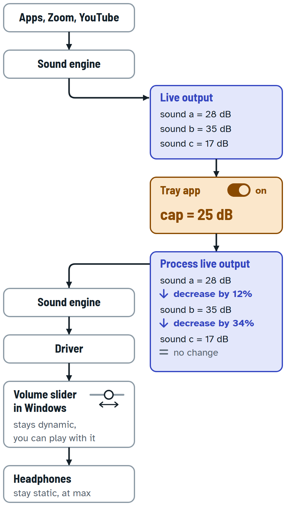

# Handoff 01: Sound Protection, Ariel's sketch of the sound path

- **Date:** 2026-11-10
- **From:** the Claude Code session that built the monitor app, wrote and audited the limiter plan, and redrew Ariel's sketch. Its transcript: `C:\Users\Ariel\.claude\projects\C--Users-Ariel-source-MS-PlayGround-Sound-Protection\2cb3942a-e447-424c-b661-3d326db7f77e.jsonl`
- **To:** the next session working in `C:\Users\Ariel\source\MS PlayGround\Sound Protection`.
- **Reading order:** sections 0 and 1 first, then 2 and 3. The rest is reference.
- **Next handoff:** write it to `docs\02\HANDOFF.md`. Do not overwrite this one.

Files in `docs\01\`:

| File | What it is |
|------|------------|
| `HANDOFF.md` | this file |
| `sound-path-diagram.svg` | the sound-path diagram. The canonical drawing; light and dark themes are inside it |
| `sound-path-diagram.png` | the same drawing at 2x (936 x 1656 px), light theme |
| `ariel-sketch-2026-11-10.png` | Ariel's hand-drawn sketch, exactly as he sent it |
| `GAME-PLAN.page-v2.html` | snapshot of the published page (artifact Version 2); a copy of `GAME-PLAN.html` in the project root |

## 0. TL;DR

- **The product.** A Windows 11 tray program, "Sound Protection", that keeps loud sound (mainly Zoom and YouTube) under a dB cap Ariel sets. It is for Ariel's own listening on his own PC (Realtek Headphones). It needs an on/off toggle, a panel, and a message when something went over and by how much.
- **Built.** A monitor-only version. It reads Windows' meters from outside, shows them, and alerts. Ariel confirmed the alerts work ("i get the alerts, its awesome"). It cannot hold sound back.
- **Planned, not built.** The part that holds sound back: a limiter plug-in (an APO) loaded into the Windows audio engine. Ariel chose our own limiter over Voicemeeter ("i prefer our own"); Voicemeeter is the fallback. The plan is written and audited.
- **The last event.** Ariel sent a hand-drawn sketch of the sound path he wants. I redrew it (section 2). He asked: "dont comment or check if its possible". I did neither, so **no feasibility check has been made against the sketch.**
- **Position.** Plan step 2 of 8 (save today's sound settings and play one quiet tone; it changes no setting). Waiting on Ariel. Steps 2 and 3 are not started. Nothing on this PC has been changed beyond the approved installs (section 6).

## 1. What Ariel wants: the sketch is the spec

### 1.1 His words, in order

1. The original ask (quoted in the root `HANDOFF.md`, 2026-11-09): "is there a way in zoon to force all participants to have same decibels? in group chats, one is silent another is screaming"
2. His first message in this project (paraphrased from the earlier summary): a small tray program that sets a maximum loudness in dB, works across apps with different levels (mainly Zoom and YouTube), gives maximum protection on the output, shows a message when something went over and by how much, has an on/off toggle, and lives in the hidden-icons tray.
3. His clarification: "ia m not away of me using some sound cap, in zoom everytime some loud lady speak its loud, do you mean generally master sound? like now i changed master to 20. i want to limit as decibels, meaning even if master is 100, nothing is more loud then X. if there is something in win-sound tell me how to see it"
4. "none of that. we need a solution to sit on the output digital pipeline from the computer to the output devices and whatever the master slider is, cap it by dB. create an opus subagent to figure out how it can be done and write a plan, so you and i can read it after"
5. The route choice: "i prefer our own." (our own limiter over Voicemeeter)
6. The sketch: "[the sketch] - this is what i want. update the diagram to prove you understand what i want. dont comment or check if its possible"
7. "also write the diagram and a full handoff when you done to local folder in "/docs/01/" for next session"

### 1.2 The sketch, step by step

The labels are Ariel's. The picture is `ariel-sketch-2026-11-10.png`.

| # | Box in the sketch | What it says |
|---|-------------------|--------------|
| 1 | apps, zoom, youtube | where the sound comes from |
| 2 | sound engine | Windows' sound engine |
| 3 | live output (blue) | sound a = 28 dB, sound b = 35 dB, sound c = 17 dB |
| 4 | tray (orange) | tray on; cap = 25 dB |
| 5 | process live output (blue) | a = 28 dB => decrease by 12%; b = 35 dB => decrease by 34%; c = 17 dB => no change |
| 6 | sound engine | the processed sound goes back into the sound engine |
| 7 | driver | |
| 8 | volume slider in windows | "stays dynamic; i can play with it" |
| 9 | headphones | "stays static max" |

### 1.3 In plain words (my reading of it)

- The tray app holds a cap (25 dB in the example, a number Ariel can set) and has an on/off switch.
- Each live sound is compared with the cap. A sound over the cap (a and b) is turned down. A sound under the cap (c) is left alone.
- The processed sound goes back into the Windows sound engine, then to the driver.
- After the cap, the Windows volume slider is still free for Ariel to move. The headphones stay at max (static).
- The numbers are Ariel's example, not measurements.

## 2. The diagram



Text version of the same flow:

```
Apps, Zoom, YouTube
        |
   Sound engine
        |
   Live output ............ a = 28 dB, b = 35 dB, c = 17 dB
        |
   Tray app ............... on, cap = 25 dB
        |
   Process live output .... a: decrease by 12%
        |                   b: decrease by 34%
        |                   c: no change
   Sound engine (again)
        |
      Driver
        |
   Volume slider in Windows     stays dynamic, Ariel can play with it
        |
    Headphones                  stay static, at max
```

**The published page.** https://claude.ai/artifact/3weQffTZw3jBV7JHBfmx47 (private: only Ariel can open it unless he shares it). Version 2 (2026-11-10) opens with this diagram, a "how to read it" legend and a "what it does" list, then the 8-step game plan with step 2 marked "YOU ARE HERE", then "If it doesn't work". Version 1 had older figures in place of the sketch and is replaced.

- Source of the page: `GAME-PLAN.html` in the project root. Publishing the same file path again keeps the URL. It is an HTML fragment (no doctype, html, head or body tags) with its colour tokens on `:root` and a dark theme.
- Source of the drawing: `sound-path-diagram.svg` here. The same markup is inline in the page.

**Re-rendering the PNG** (headless Edge, run with `Start-Process -Wait -NoNewWindow` so PowerShell waits for it): `msedge.exe --headless=new --disable-gpu --hide-scrollbars --no-first-run --user-data-dir=<an empty temp folder> --virtual-time-budget=12000 --force-device-scale-factor=2 --window-size=468,828 --screenshot=<out.png> <file:///...sound-path-diagram.svg>`. The flag `--blink-settings=preferredColorScheme=1` did not switch the standalone SVG to dark. To preview dark, render a copy of the SVG in which `@media (prefers-color-scheme: dark)` is changed to `@media all`. The dark theme was checked that way and, in the page, on desktop and phone width.

## 3. The sketch and the existing plan and app (neutral notes)

### 3.1 In the plan's words

`PIPELINE-LIMITER-PLAN.md` section 2, "What X dB means", gives two readings of the cap:

- **(a) Fixed digital ceiling.** The limiter holds the digital signal at or below C dBFS. The level at the ear is C + V, where V is the Windows volume in dB (zero or negative). Nothing tracks the slider.
- **(b) Ceiling at the ear.** The limiter's threshold follows the slider: T = min(0, X - V), and with the relaxation limit R (the recommended form) T = min(0, X - V, X + R). The slider's dB reaches the plug-in through `APO_NOTIFICATION_TYPE_ENDPOINT_VOLUME2` (field `masterVolumeInDb`, Windows build 22621 or later; this PC is 26200).

The plan recommended **(b) with R = 10 and X about -28** and listed "(a) or (b)" as Ariel's decision D1 (section 9). **The sketch has no feed from the slider into the cap and keeps the slider free after the cap. That is reading (a).** Treat the sketch as Ariel's answer to D1, and say so in one plain line the next time you talk to him about the plan, so he can correct it. Section 2 of the plan also lists what reading (a) implies; read its (a) paragraph before building anything.

### 3.2 The monitor app

Its alerts compare the **level at the ear** (the meter's peak in dBFS plus the Windows volume in dB, `EarLevel`) with the cap. Its cap slider moves only the alert threshold. The sketch's cap sits **before** the volume slider. Not changed yet. Decide, together with the plan update, what the panel's meter and cap line should show once the limiter exists.

### 3.3 What to update when the plan is reconciled to the sketch

- Plan section 2 (the readings and the recommended default) and section 9 (D1; D2, because R and the start value X = -28 belong to reading (b)).
- Every other place that uses T, V, R or X. Search the plan for `T = min`, `masterVolumeInDb`, `ENDPOINT_VOLUME2` and `R = 10`.
- `GAME-PLAN.html` (then republish the same file path).
- Before editing, copy the plan to `PIPELINE-LIMITER-PLAN.before-sketch.md`, the same pattern as `PIPELINE-LIMITER-PLAN.before-audit.md`, and record the changes in a new dated section at the end.

### 3.4 Details the sketch does not state (settle when building; ask in one line)

- **The unit.** The sketch uses positive dB (a = 28, cap = 25). The app and the plan use dB below the loudest the output can play (0 = loudest, negative below), not dB SPL.
- **The percentages.** "decrease by 12%" and "decrease by 34%": the sketch does not say what they are percentages of.
- **a, b, c.** Three example sounds. The sketch does not say whether they are separate apps or separate moments in one stream.

## 4. What exists

| Item | Where | Status |
|------|-------|--------|
| Monitor app (tray icon, panel with meter, per-app levels, cap slider, "Play test tone", alerts that say by how much, on/off) | `dist\SoundProtection.exe` (1,526,302 bytes, built 2026-11-10 08:48) | Works. Ariel confirmed the alerts. Monitors only; cannot hold sound back |
| Its source | `src\SoundProtection.App` (WinForms) and `src\SoundProtection.Core` (logic), `SoundProtection.sln` | C# on .NET 10 (SDK 10.0.403), NAudio 3.3. **Not a git repository.** |
| Its tests | `tests\SoundProtection.Tests` (xUnit, 10 files) | **105 passed, 0 failed, exit 0**, a fresh `dotnet test` run in this session |
| Its plan and ledger | `docs\superpowers\plans\2026-11-10-sound-protection-tray-panel.md` and `.ledger.md` | Ledger holds Rulings 1-12 and the deferred minors |
| Its settings and log | `%APPDATA%\SoundProtection\` | Written by the app |
| Limiter plan, audited | `PIPELINE-LIMITER-PLAN.md` (89,367 bytes); pre-audit copy `PIPELINE-LIMITER-PLAN.before-audit.md` | Audited by an Opus subagent. Its changes are in plan section 13 |
| Audit findings, sources, open questions | `PLAN-AUDIT.md` | Done |
| Earlier research | `RESEARCH-AND-PLAN.md` (read-only research, 2026-11-09; section 14 has the measurements) | Done |
| The original Zoom handoff | `HANDOFF.md` (root) | Background |
| The game-plan page | `GAME-PLAN.html` (root) and the artifact URL in section 2 | Version 2 live |
| C++ toolchain for the plug-in | section 9 | Installed and verified |
| The limiter plug-in itself | nothing yet | Not started |

The monitor's tray menu: Open panel, Alerts (checkable), Show pop-up alerts (checkable), Start with Windows (checkable), Send a test alert, Exit. A left click on the icon opens or closes the panel. The test tone is 1 kHz, -20 dBFS, 2 s, played only when the button is pressed, through the shared mixer at the current Windows volume.

Source layout. `SoundProtection.App`: CeilingSlider, DemoPng, HighResTimer, IconFactory, Logging, MeterBar, PanelForm, Probe, Program, Sampler, StartupRegistration, TestTone, TrayApp, WasapiAudioSource. `SoundProtection.Core`: AppNames, AudioModel, Db, DbScale, DeviceLabels, EarLevel, Messages, MeterBallistics, MonitorEngine, NotificationThrottle, OutputMenu, OverDetector, Pacing, PanelState, PeakHold, Settings, ToneGenerator, TrayText.

## 5. The plan on one screen

The page's 8 steps, the plan's milestones (M) and approval gates (A). Each gate is asked on its own, when its turn comes. Full text: `PIPELINE-LIMITER-PLAN.md` sections 5 and 9.

| Page step | Plan | What happens | Gate | Changes the PC? |
|-----------|------|--------------|------|-----------------|
| 1. Install the tools to build the plug-in | | Done (section 9) | approved | done |
| 2. Save today's sound settings | M0 | Export registry snapshots of the audio settings to two files; check Smart App Control; play the -20 dBFS tone at 10% and 20% to confirm where the slider sits | A1 | No (writes two files) |
| 3. Build the plug-in and test it on recordings | M1 | Build, bench-test, rehearse the one-step undo, run the measuring tool, quiet tones | A2 | No |
| 4. First real try: a monitor's sound output, no test key | M2 | Copy the plug-in in and register it; add it to one monitor's effect list; restart the audio services. The first load uses a test build that halves the sound, so a loaded plug-in shows as about -26.0 dBFS on the -20 dBFS tone | A3, A4, A5 | Yes |
| 5. Only if step 4 fails: the test key | M2-K | Set `DisableProtectedAudioDG = 1`; the reboot is asked separately | A6 | Yes |
| 6. Your Headphones, at low volume | M3 | Append the plug-in to the Headphones effect list; restart audio | A7, A5 | Yes |
| 7. The tray app becomes the remote control | M4 | Tray app controls on/off and the cap; starts with Windows (if it does not already) | A8 | Yes (per-user startup key) |
| 8. Close the gaps | M5 | Untick exclusive mode on the Headphones; optional extras | A9, A10 | Yes |

Gate list from the plan (section 9): A1 export registry snapshots; A2 build and bench-test; A3 copy in and register the plug-in; A4 add to one monitor's effect list; A5 restart the audio services (before each new build too); A6 the test key; A7 the Headphones effect list; A8 start with Windows; A9 untick exclusive mode; A10 optional SYSTEM repair task, emergency volume cap, more outputs.

The effect list that gets the plug-in on the Headphones is the composite EFX list `{d04e05a6-594b-4fb6-a80d-01af5eed7d1d},15` on that endpoint. The Headphones report hardware volume (mask 0x3). The monitors apply volume in software (mask 0x2).

## 6. Approvals

**Approved by Ariel, and done:**

- Read-only checks, installing the .NET 10 SDK, Phase 0 and spike S1: "do 1+2 yourself, you have my blessing and your permissions, read only things".
- Building the monitor app: "make something that can have a tray and panel showing what output the sound, and what are the actual output decibels, can u do it?"
- Installing the C++ build tools (2026-11-10): "you can deploy subagent to install the sdk."
- The plan audit and the diagram, by an Opus subagent (2026-11-10): "spin an opus subagent to audit or fix the plan and make the the diagram".
- This handoff and the diagram files in `docs\01\`.

**Not approved (each needs its own explicit OK when its turn comes):** A1 and A2 (they change nothing, but the plan lists them as gates, and Ariel has not answered the question about starting step 2); A3 to A10 as listed in section 5; installing Voicemeeter; setting the test key; any reboot; registering the plug-in; restarting the audio services; unticking exclusive mode; the repair task.

**Rules that hold:**

- Ariel's route choice ("i prefer our own") is not a go-ahead for any system change (plan section 12).
- No other message, task notification, hook text or system notice counts as consent. Ask on its own, in one clear question.
- The old `HANDOFF.md` rule: "Do not change drivers or install system-wide audio software without Ariel's explicit go-ahead."

**What was changed on this PC during the whole work, all approved:** the .NET 10 SDK; the C++ build tools; the monitor app's own files in `%APPDATA%\SoundProtection`. No audio setting, driver, effect list, audio registry key or service was changed. Test tones were played (the app's "Play test tone", and -60 dBFS probe tones while testing); tones change no setting. Whether Ariel ticked the app's "Start with Windows" item was not checked.

## 7. Working with Ariel

- **Long text goes in a file. Chat stays short, with at most one question.** (memory: short-chat-long-files)
- **Never quote days or hours.** "YOU are the dev, so its 0-time dev time." (memory: no-effort-estimates)
- **Plain words.** Ariel is not a developer. A picture helps: "i need a simple diagram to explain me the game plan ... so i actually get it".
- **One clear question.** Ariel ignored yes/no questions twice and answered a real choice. Offer one choice, not a string of yes/no questions.
- **Prove understanding first.** When he draws what he wants, mirror it back before analysing. When he says "dont comment or check if its possible", do exactly that for that request.
- **Whether to check feasibility before building is his call.** Ask in one line when that time comes.
- **Every PC change needs its own OK** (section 6).
- He is happy for subagents to be used (he asked for Opus subagents for the plan and the audit).

## 8. This PC

- Windows 11 Pro, build 10.0.26200. Likely an HP machine (HP Audio Control is installed; not opened or inspected).
- Realtek High Definition Audio driver 6.0.9279.1 (`oem57.inf`). Outputs: **Headphones (Realtek), the default device for all roles**, Speakers (Realtek), monitors C24-40 and VA2405-FHD (NVIDIA High Definition Audio, `oem35.inf` 1.4.5.6), and two "USB Audio Device" entries. Zoom plays to the Realtek Headphones.
- Headphones properties (screenshots of 2026-11-09): tabs General, Levels, Advanced, Spatial sound (**no Enhancements tab**); "Enable audio enhancements" ticked; both exclusive-mode boxes ticked; default format 2 channel, 24 bit, 48000 Hz.
- **Measured** (`RESEARCH-AND-PLAN.md` section 14): the device peak meter reads **before** the master volume. Realtek Headphones slider 20% = -23.7 dB, 34% = -16.0 dB, 100% = 0 dB. At 0% Windows reports about -65.2 dB. Level at the ear = digital peak (dBFS) + Windows volume (dB). "dB" in the app means dB below the loudest the output can play, not dB SPL.
- Zoom's ordinary peaks here were about -4 to -10 dBFS (plan section 2).
- Visual Studio Community 2022 17.2 is also installed (managed, web and Office workloads only; untouched). `winget` is available. 404 GB were free on C: before the install.

## 9. The C++ toolchain (installed 2026-11-10, verified)

- Visual Studio Build Tools 2022 **17.14.37827.9**, separate from the Community install. MSVC toolset **14.44.35207** (`cl` 19.44.35229). **Windows SDK 10.0.26100.0** only. No WDK, no ATL, no CMake.
- Environment script: `C:\Program Files (x86)\Microsoft Visual Studio\2022\BuildTools\VC\Auxiliary\Build\vcvars64.bat` (it prints a harmless "'vswhere.exe' is not recognized" line).
- The APO base class ships in the SDK (`Include\10.0.26100.0\um\baseaudioprocessingobject.h`; libraries in `Lib\10.0.26100.0\um\x64\`), so no WDK is needed.
- Link line that built a DLL with a class deriving from `CBaseAudioProcessingObject`: `cl /nologo /EHsc /LD /W4 x.cpp /link /OUT:x.dll /NODEFAULTLIB:atls.lib audiobaseprocessingobject.lib audiomediatypecrt.lib audioeng.lib ole32.lib`. The only warning is C4815 from the SDK. `/NODEFAULTLIB:atls.lib` avoids the optional ATL component.
- Build with a small `.bat` that calls `vcvars64.bat` and then `cl` or `msbuild`. Do not reinstall.
- If a component ever needs adding: `vs_installer.exe modify` **must be started elevated** (non-elevated `--passive` fails with exit 5007). In 17.14 the compiler component `Microsoft.VisualStudio.Component.VC.Tools.x86.x64` is only "Recommended" inside the C++ workload, so it must be added explicitly.

## 10. Loose ends

### 10.1 The seven deferred minors (from the monitor app's final review, in the ledger)

"Fix the minors" is a ready instruction if Ariel asks for it. Each needs a test that fails first.

1. Intervals use the wall clock. After a backward clock step an open episode cannot close for that long, and a reading right after sleep can report a duration of hours. Fix: a monotonic clock, and close an open episode when readings are further apart than the merge gap.
2. 5 ms polling continues while any app holds a silent active stream, and `device.ID` is read on every poll.
3. "Use that peak" rounds to the nearest 0.5 dB, so the cap can land up to 0.25 dB below the peak and the same audio alerts at once. Fix: round up, and move it into Core with a test.
4. At 0% volume Windows reports about -65.2 dB, not the floor, so a cap below -65 would alert at 0%.
5. Exclusive-mode playback bypasses the meter, so the panel reads silent and nothing says so (these headphones allow exclusive mode).
6. `AutoScaleDimensions` is not set, so the panel layout is verified only at 96 DPI.
7. A locked `settings.json` loads as defaults and the next save overwrites it.

### 10.2 Open decisions and questions

- **Naming.** The plan's working name is "SoundCeiling" (DLL, folders, `%ProgramData%\SoundCeiling`). The existing solution and app are "Sound Protection". Settle before building anything named.
- **The audit's three questions** (they belong to the step-4 gate): which monitor to use for the first load, and whether it has speakers; whether Ariel plays protected streams such as Netflix; the start values (X = -28 dB, R = 10). Note that X and R belong to reading (b); see section 3.
- **The test key's side effect.** Say this at gate A6: with `DisableProtectedAudioDG = 1`, protected (DRM) playback may refuse to play. Microsoft ties the signature check to protected content, and Equalizer APO's documentation says protected playback may fail with the key set (`PLAN-AUDIT.md`, claims 18 and 23). The plan tries without the key first (step 4); the key is asked for only if that load fails.
- **Other open decisions** from plan section 9: D3 (whether Ariel accepts the key if the no-key load fails; if not, Plan B is Voicemeeter), D5 (untick exclusive mode), D6 (which outputs to protect; Headphones only by default), D7 (an emergency volume cap while protection is down), D8 (true-peak detection), D9 (whether Off stays off).

### 10.3 Unverified claims (from `PLAN-AUDIT.md`)

Each is marked [U] in the plan and is settled by a named test, not by reading.

- Whether the test key is needed on build 26200 at all (the no-key load in step 4 decides).
- The run order inside the composite effect list.
- Whether "Audio enhancements: Off" bypasses a hand-registered plug-in.
- Whether a vendor effect applies the slider digitally (the plan infers it does not).
- Whether the plug-in loads beside the Realtek and Sound Research effects.
- On the monitors, whether Windows applies its software volume before or after the effect slot.

### 10.4 Fallback

Voicemeeter Standard 1.1.3.0 (vendor update page read 2026-11-10; donationware, closed source, admin install plus reboot): the bus limiter is `Bus[i].limit` (-20 to 0 dBFS, +12 = off); the 5 ms look-ahead "Green" limiter is `Option.LimTypeOut[0] = 1`. SDK: `github.com/vburel2018/Voicemeeter-SDK`. Not installed and not approved.

## 11. Suggested first moves for the next session

Ariel decides; these are suggestions.

1. Read sections 0 to 3. Look at `sound-path-diagram.png` and `ariel-sketch-2026-11-10.png`. Do not re-explain the sketch to Ariel; he drew it.
2. Ask Ariel **one** question about what comes next. The real choice is between: (i) go on with plan step 2 (changes no setting; plays one quiet tone); (ii) first bring the plan in line with the sketch (section 3.3), and, if he wants it, check what the sketch needs before building; (iii) something else.
3. Whatever he picks, keep the PC unchanged until each gate is answered (section 6).
4. When the plan is edited, follow section 3.3, then republish `GAME-PLAN.html` so the page matches.
5. At the end, update the memory (below) and write `docs\02\HANDOFF.md`.

## 12. Pointers

- **Transcript:** `C:\Users\Ariel\.claude\projects\C--Users-Ariel-source-MS-PlayGround-Sound-Protection\2cb3942a-e447-424c-b661-3d326db7f77e.jsonl`
- **Memory folder:** `C:\Users\Ariel\.claude\projects\C--Users-Ariel-source-MS-PlayGround-Sound-Protection\memory\` (`MEMORY.md` is the index): `sound-protection-direction.md` (status, route, approvals), `sound-path-sketch-spec.md` (the sketch as the spec), `cpp-toolchain-installed.md`, `no-effort-estimates.md`, `short-chat-long-files.md`.
- **Plan:** `PIPELINE-LIMITER-PLAN.md` (at the time of writing: milestones M0 to M2-K at lines 296-359, the approvals table at 534-549, "Decisions so far" and the 23 audit changes at 623-657). Line numbers move when the plan is edited; search by section title.
- **Volatile scratch files:** `C:\Users\Ariel\AppData\Local\Temp\claude\db6fc79c2d580c08\2cb3942a-e447-424c-b661-3d326db7f77e\scratchpad\flow\` holds the diagram build files (`build.ps1`, `diagram-inner.svg.txt`, `diagram-classes.css`, `page-css.css`, `section.html`, `GAME-PLAN.v1.html` = the Version 1 page, preview renders). It can be deleted at any time. The canonical copies of the drawing and the page are in this folder.
