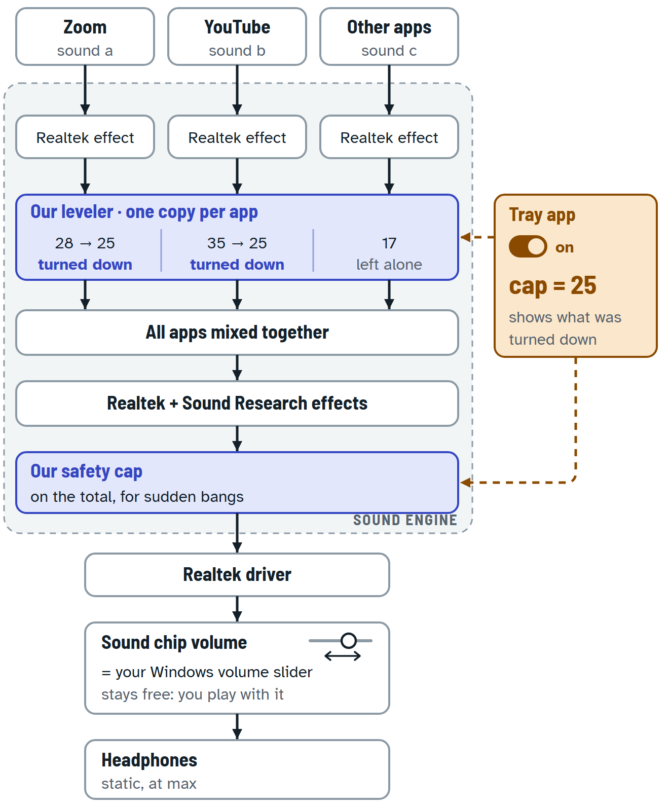

# Sound Protection: how your sketch gets built on Windows 11

Plan 3 · 10 Nov 2026 · for Ariel and the next session

- **What you want:** your sketch of 10 Nov 2026, [`../01/ariel-sketch-2026-11-10.png`](../01/ariel-sketch-2026-11-10.png), redrawn in [`../01/GAME-PLAN.page-v2.html`](../01/GAME-PLAN.page-v2.html).
- **This plan as a page:** [`GAME-PLAN.html`](GAME-PLAN.html).
- **Diagram:** [`sound-path-in-windows.png`](sound-path-in-windows.png) (also `.svg`).

**Evidence marks**
- **[PC]**: read on your PC on 10 Nov 2026. Read-only; nothing was changed.
- **[Doc n]**: official documentation or source code (Microsoft, Chromium, Zoom, ITU).
- **[Rep n]**: reported by others (forums, GitHub).
- **[Mine]**: my inference, not yet tested. Each one has a test in section 7.

Numbers point to the sources in section 10.

---

## 0. The short answer

Yes, it can be done. Windows 11 has one place where every app's sound can be changed before your volume slider without replacing the driver. That place is an effect plug-in inside Windows' sound engine (audiodg.exe). Your Headphones already run Realtek's and Sound Research's plug-ins there **[PC]**, and ours would sit next to them.

**Way 1: the real cap (recommended).** This is our own plug-in, in two parts.
- **A leveler in the per-app slot.** Windows runs "an instance of the effect for every stream" **[Doc 1]**. So each app is turned down on its own, like a, b and c in your sketch.
- **A safety cap at the end, on the total,** for sudden bangs.
- **Your volume slider comes after both parts.** Your Headphones do their volume in the sound chip **[PC]**, so the slider stays free.
- **The catch:** Windows normally loads only plug-ins it has signed. The exception is when the "test key" is on **[Doc 4]**, and we found no report of an unsigned plug-in loading without it. So expect to need the test key. Its side effect is that some copy-protected video may refuse to play while it is on **[Rep 11]**.

**Way 2: the quick version (no install).** The tray app turns down each loud app's own volume, meaning the per-app sliders in Windows' Volume Mixer. It lets the volume back up when the app gets quiet.
- **The good:** nothing to install, no admin rights, no test key, and the master slider stays free.
- **The catch:** it reacts after the loud part has started. Another tool doing this reports 10–30 ms **[Rep 33]**. The per-app sliders visibly move, and a sudden bang gets through.

**My suggestion:**
1. Use Way 2 first, to feel the cap: which number, and how fast.
2. Build Way 1 alongside, safely, on recordings.
3. Then take Way 1's PC steps one OK at a time.

Each step that changes your PC is asked on its own.

---

## 1. Your sketch, box by box

| Your sketch | In Windows 11 | Evidence |
|---|---|---|
| Apps: Zoom, YouTube, others | Each app sends its own stream into the sound engine. All Chrome tabs share one stream; a browser call can open a second one. Zoom runs two processes. | [Doc 1, 9] [PC] |
| "Process live output": a and b turned down, c left alone | **Way 1:** our leveler in the Headphones' per-app list, right after Realtek's per-app effect. One copy runs per stream. **Way 2:** each app's own volume. | [PC] [Doc 1, 3] |
| Back into the sound engine | The apps are mixed. Then the Headphones' end-of-line effects run: Sound Research, then Realtek. Our safety cap goes last. | [PC] |
| Driver | The Realtek driver. | [PC] |
| Volume slider, "stays dynamic" | Your Headphones do their volume in the sound chip (hardware volume, support mask 0x3), measured earlier. The hardware applies that volume **[Doc 7]**, so it comes after every plug-in. | [PC: `RESEARCH-AND-PLAN.md` §14] [Doc 7] [Mine; tone test in steps 4 and 8] |
| Headphones, "static max" | Unchanged. | — |
| Tray app: on, cap = 25 | Sends on/off and the cap to the plug-in through a small settings file. Shows what was turned down, per app. | design |

**Your Headphones' effect lists today [PC]**

| List | Holds today | We add |
|---|---|---|
| Per-app (`{d04e05a6-…},13`) | Realtek per-app effect | our leveler, after it |
| Per-mode (`,14`) | Realtek | nothing |
| End of line (`,15`) | Sound Research, then Realtek | our safety cap, last |
| Offload (`,19`, `,20`) | Realtek; Realtek + Sound Research | nothing, unless step 8 shows YouTube skips us |
| Modes (`{d3993a3f-…},5 ,6 ,7 ,11 ,12`) | Default only, in every list | nothing |

**Also on your PC [PC]**
- Windows 11 25H2, build 26200.9711.
- The test key is not set.
- Audio enhancements are on for all four outputs.
- Your two monitors carry Microsoft's own enhancement plug-ins, and their end-of-line slot is empty.
- Windows' per-app volume store has entries for Zoom and Chrome.

---

## 2. What "too loud" means

- **Loudness, not peaks.** The leveler measures each app the way broadcasters do: ITU-R BS.1770-5 loudness over the last 0.4 s **[Doc 17]**.
  - Over the cap, the app is turned down smoothly to the cap.
  - When it is quieter again, it comes back up over about a second, never above where it was.
  - Quiet apps are never turned up.
- **Why not a plain limiter at the cap.** A low peak ceiling squashes voices; the earlier plan warned about this for a cap placed before the slider.
  - So the safety cap sits a margin above the cap and only catches bangs.
  - It looks 5 ms ahead and uses the settings in `PIPELINE-LIMITER-PLAN.md` §4.6.
  - The margin starts at 12 dB (my call), and step 5 tunes it on recordings.
- **The cap's unit.** Before the slider, the PC only knows the digital level: 0 is the loudest it can make, and everything else is negative. I read your numbers (25, 28, 35, 17) as an example.
  - **Digital scale (recommended).** The panel shows each app's live level and the cap on one scale, for example a cap of −20. You set the cap by watching a loud call. It means the same whatever the slider position.
  - **dB at your ear.** A one-time reading with a phone sound-meter app makes this possible. But it is only true at one slider position, because the slider comes after the cap. I don't recommend it for the cap itself.
- **"Decrease by 12%".** The panel shows how much each app was turned down, in dB and in %.
- **Two apps at once.** Each is capped on its own, as in your sketch. Together they can be up to about 3 dB louder than one alone, and the safety cap still stops bangs (my call).

---

## 3. Way 1: our plug-in inside the sound engine (recommended)

### 3.1 Good news from the research

- **Hand-registered plug-ins still load on 24H2/25H2 with the test key on.**
  - Equalizer APO's maintainer, 20 Jun 2026: "I'm currently on 26200.8655 and have no issues" **[Rep 13]**.
  - Your build is 26200.9711 **[PC]**.
- **One copy per stream.** "A stream effect APO has an instance of the effect for every stream" **[Doc 1]**.
- **YouTube should pass our leveler** **[Mine]**.
  - Chrome plays in shared mode, sets no "raw" option, and sets a category only for offload **[Doc 9, 10]**. So YouTube should land in the Default mode.
  - Default is the only mode your Headphones list **[PC]**. If a stream asks for a mode that isn't listed, "Windows will use the next best matching mode" **[Doc 5]**.
- **Nothing gets removed.** Your Headphones already use multi-plug-in lists, so ours is added next to Realtek's **[PC]**.

### 3.2 The catches, and what we do about each

1. **Test key.**
   - Microsoft: "The audio engine does not normally load an unsigned sAPO" **[Doc 4, 2012]**.
   - The bypass is the `DisableProtectedAudioDG` value. Microsoft's 2025 page still calls it "this test key" **[Doc 2]**.
   - Neither the research agent nor my own search found a credible report of an unsigned plug-in loading without it **[Rep]**.
   - Side effect: "the protected audio path is broken, making some software using DRM refuse to output any sound" **[Rep 11]**.
   - Zoom calls and ordinary YouTube videos aren't copy-protected **[Mine]**; paid films and streaming services can be.
   - → Step 6 tries without the key anyway. Step 7 checks that what you watch still plays.
2. **Windows and driver updates.**
   - Updates have broken hand-registered plug-ins for some people:
     - 24H2, April 2025;
     - KB5078127, January 2026, fixed with a restore point **[Rep 12, 13]**.
   - A Realtek driver reinstall rewrites the effect lists and drops ours **[Rep 14]**.
   - → The tray checks after every start and offers a one-click Repair.
3. **"Audio enhancements: Off" switches us off.**
   - After 10 plug-in failures, Windows sets the flag behind the "Audio enhancements" switch. Microsoft's 2025 page says that flag disables "the SFX, MFX and EFX APOs" **[Doc 2, 40]**.
   - So switching enhancements off very likely stops ours too **[Mine]**. Step 10 tests it.
   - A crashing plug-in would also take Realtek's effects down **[Mine]**.
   - → The plug-in is built not to fail: no memory allocation in the sound path, and bad values are clamped. The tray shows "Protection is OFF" in red.
4. **The plug-in can't tell which app it is processing.** Windows tells it the mode, not the app **[Doc 6]**.
   - → The tray matches each copy to an app by comparing levels with the per-app meters it already reads **[Mine; step 9]**.
5. **Zoom might be "raw".**
   - "Stream effects are not used for raw streams" **[Doc 1]**.
   - Nothing says whether Zoom plays raw. The "raw" option that sources describe is for the microphone, and none says it affects playback **[Rep 16]**.
   - If it does play raw, Zoom is still held by the safety cap on the total. When Zoom is the only thing playing, the total is Zoom **[Mine]**.
   - → Step 8 checks.
6. **Offload.**
   - Offloaded streams "will not be passed through the software audio engine" **[Doc 8]**, and Chrome can ask for offload **[Doc 9, 10]**.
   - Desktop Realtek chips usually can't offload **[Mine]**.
   - → Step 8 checks that YouTube appears in the plug-in's log.
7. **Exclusive mode.** An app that takes sole control of the Headphones skips the engine entirely.
   - → Step 10.

### 3.3 For the builder

- **Registration** (Headphones; Speakers later if wanted):
  - Append our CLSID to `{d04e05a6-594b-4fb6-a80d-01af5eed7d1d},13`, after `{DA2C9ECE-7418-4906-B4FA-0A00B3EB88AA}` (CRtkAPOSFX).
  - Append it to `,15`, after `{8F3540DF-18B0-4943-B916-D4A79801587D}` (SEAPOEFX) and `{A29EB043-6CE2-4ee2-B38C-F58719E0D88F}` (CRtkAPOEFX).
  - The mode lists `{d3993a3f-99c2-4402-b5ec-a92a0367664b},5` and `,7` already hold Default `{C18E2F7E-933D-4965-B7D1-1EEF228D2AF3}`.
  - The association value `,0` (GUID_NULL) is present on all four outputs **[PC]**. A 2026 report says the engine skips an endpoint without it **[Rep 15]**.
- **Monitor first-load (step 6).** The monitors have neither `{d04e05a6-…},7` nor `{d3993a3f-…},7` **[PC]**. Add both: our CLSID, and Default.
- **One DLL, two COM classes:** `SoundProtection.Leveler` (per-app list) and `SoundProtection.SafetyCap` (end of line).
  - Register with `MaxInstances` 0xffffffff, as Microsoft's sample does **[Doc 2]**.
  - Build without an embedded manifest. Otherwise the plug-in "will fail to load, even if it is WHQL-signed", once the test key is removed **[Doc 2]**.
  - Toolchain and link line: `../01/HANDOFF.md` §9.
- **Settings and telemetry:**
  - As in `PIPELINE-LIMITER-PLAN.md` §4.2, renamed to `%ProgramData%\SoundProtection\`.
  - Give read access to LOCAL SERVICE, `S-1-15-2-1` and `S-1-15-2-2`. One 2026 report says audiodg runs in a restricted app-container sandbox **[Rep 15]**.
  - Alternative to test: Windows 11's effects property store. It is "readable and writable by … non-admin desktop applications" and sends change notifications **[Doc 3]**. It is untested for hand-registered plug-ins.
- **Leveler:**
  - K-weighting (BS.1770-5 shelf plus high-pass) **[Doc 17]**, and 400 ms loudness.
  - Gain = min(1, 10^((cap − L)/20)), smoothed: about 0.1 s down and about 1 s up, both tuned in step 5.
  - Gain never goes above 1, and there is no look-ahead.
- **Safety cap:**
  - Settings from §4.6: 5 ms look-ahead, 20 ms hold, 80–400 ms automatic release, 4× true peak, full stereo link, final clipper.
  - Ceiling = min(cap + margin, −1 dBFS).
- **Telemetry per copy:** slot, mode, sample rate, input loudness, gain reduction and a heartbeat.
- **Health checks:**
  - The enhancements-off flag `{1da5d803-d492-4edd-8c23-e0c0ffee7f0e},5` on the endpoint.
  - Our CLSID still in `,13` and `,15`.
  - A fresh heartbeat.
  - Microsoft's own sample plug-in checks the enhancements switch itself **[Doc 39]**. Step 10 tests what ours does.

---

## 4. Way 2: the quick version, no install

### 4.1 How it works

The tray app already reads each app's live level. Way 2 adds a "rider":
- When an app goes over the cap, the tray lowers that app's own volume just enough.
- When the app is quiet again, the tray brings it back up over about a second, never above where you left it.
- Your master slider is never touched.

### 4.2 What we found

- **We found no built-in loudness cap** in Windows 11 (24H2, 25H2, a 26H2 summary and the 2026 Insider builds), in Zoom or in Chrome.
  - Windows: [Doc 18] [Rep 19].
  - Zoom offers only "Output volume: Adjust the volume slider as needed" **[Doc 20]**.
  - Chrome: [Doc 9, 10, 21].
- **The trick is practical.** A new open-source tool, Levelo (beta, Nov 2026), already does it **[Rep 33]**:
  - "Loud parts are lowered in ~10–30 ms";
  - it "recovers in about 1 s";
  - it restores levels "after a crash (on the next start)".
  - We don't install it; it shows the trick works.
- **Per-app meters refresh once per period.** A reading is "recorded over one device period and made available during the subsequent device period" **[Doc 25]**, and apps use 10 ms periods by default **[Doc 26]**.
- **Per-app recording ("process loopback")** hears each app after its own volume and before the master **[Rep 30; Doc 31]**. That makes an exact loudness measure possible later.

### 4.3 The catches

1. **The start of each loud part gets through.** That was 10–30 ms in Levelo's case **[Rep 33]**. Way 2 can't stop a bang.
2. **The per-app sliders move** in the Volume Mixer, and Windows tells every app that is listening **[Doc 22, 28]**.
3. **A lowered level can stick.**
   - Windows keeps each app's volume across restarts and crashes. A new instance "inherits the previously saved volume and mute settings" **[Doc 27]**.
   - → The tray saves the original levels to a file before the first change. It restores them on exit, on "off", and on the next start.
4. **Microsoft's guidance:** an app "should not attempt to … control the volume level of a session that is owned by another, unrelated application" **[Doc 27]**.
   - It works, but it isn't the intended use.
   - Windows' call ducking could move the same sliders, and so could Chrome's experimental ducking, which sits behind a flag **[Doc 21]**.
5. **All Chrome tabs are one app.** A browser call can be a second Chrome session **[Doc 9]**.
6. **One unknown:** whether an app's meter reads before or after that app's own volume.
   - Microsoft doesn't say, and the clues point both ways **[Doc 22; Rep 23]**.
   - → A one-minute test in step 3 settles it, and the rider can handle either answer.
7. **Windows' call ducking stays as it is.** By default it lowers other sounds by 80% during calls **[Doc 37]**.

### 4.4 For the builder

- Poll the session meters every 10 ms, on a dedicated thread.
- **Level:** average the 10 ms peaks over 0.4 s, which is close to loudness. Later option: process loopback, for true BS.1770 loudness.
- **Per session:** target = min(original, original × 10^((cap − level)/20)). Turn down at once, and back up over about 1 s.
- **Telling our changes from yours:**
  - Call `SetMasterVolume` with our own event-context GUID.
  - A change with any other context came from you or another app, and it becomes the new "original".
- **Saving and restoring:**
  - Before the first change, save `{process, session id, original}` to `%LOCALAPPDATA%\SoundProtection\rider-state.json`.
  - Restore on exit, on off, and at start if the last run didn't exit cleanly.
- Skip sessions whose meter reads 0.0: they are silent, or in exclusive mode.
- When Way 1's plug-in is running and healthy, the rider stays off.

---

## 5. Routes we don't recommend

| Route | Why not |
|---|---|
| Voicemeeter, a virtual cable, "audio-limiter" | Your Windows slider would then control the virtual device, which comes **before** the cap: the opposite of your sketch. These add delay (about 35 ms reported for audio-limiter **[Rep 34]**) and go silent if they crash. Voicemeeter stays the fallback. |
| Tools that move or lock the master volume (Sound Lock, Volume Limiter) | They turn down or lock your slider: "With the lock on, you cannot change the volume at all" **[Rep 36]**. Your sketch keeps the slider free. |
| Windows' Loudness Equalization | It comes with Microsoft's enhancement plug-ins. Your Realtek Headphones use Realtek's instead **[PC]**, so it would need a driver swap, which you turned down. |
| The driver's volume-limit hook | It "passes an end user's volume level limit preference to the underlying driver" **[Doc 38]**. That caps the slider, not loud sounds, and only if the driver supports it. |
| App settings | Zoom has only a manual speaker slider **[Doc 20]**. YouTube's "Stable volume" works inside YouTube only (earlier research). |

---

## 6. The game plan

| # | Step | Tag | Changes on your PC | Undo |
|---|---|---|---|---|
| 1 | Install the tools to build the plug-in | Done | — | — |
| 2 | Your sketch, the research, this plan | Done | — | — |
| 3 | **Quick version (Way 2).** The tray turns loud apps down. It starts with the one-minute meter test. | **Needs your OK** | While it is on, the volume of each app over the cap (Zoom, Chrome …) | Switch it off: every app goes back where it was. This also happens on exit and on the next start. |
| 4 | Save today's sound settings. A quiet test tone confirms the slider acts after the plug-in point. | Safe | — (two backup files in the project folder) | — |
| 5 | Build the plug-in (leveler and safety cap) and test it on Zoom and YouTube recordings. Write and rehearse the one-step undo. | Safe | — | — |
| 6 | First real try on a monitor's output, no test key. I expect it not to load. | **Needs your OK** | Our plug-in added to one monitor output. Sound pauses while Windows' audio restarts. | One-step undo |
| 7 | Only if step 6 fails: the test key. Then check that Zoom, YouTube and anything copy-protected you watch still play. | **Needs your OK** (the restart is asked separately) | One Windows setting, then a PC restart | Delete it, restart |
| 8 | Headphones at low volume: the per-app part and the safety cap. Check that Zoom and YouTube both pass through. | **Needs your OK** | Our plug-in added to two Headphones lists, after Realtek's | One-step undo |
| 9 | The tray app becomes the remote control: on/off, the cap, and what was turned down per app (in dB and %). The quick version hands over to the plug-in. | **Needs your OK** | The tray app starts with Windows | Untick it in the menu |
| 10 | Close the gaps: exclusive mode off, Repair after Realtek updates, and a red warning if Windows switches effects off. | **Needs your OK** | One Headphones setting | Tick the box again |

Steps 6–10 are the earlier plan's milestones M2–M5 and gates A1–A10 (`PIPELINE-LIMITER-PLAN.md` §5 and §9). Steps 4–5 are M0–M1, and step 3 is new.

---

## 7. What we don't know yet, and which step finds out

| Unknown | How we find out | Step | My expectation |
|---|---|---|---|
| Does an app's meter read before or after its own volume? | Play a tone in Chrome, set Chrome to 50%, and see whether the meter halves | 3 | Unknown; the rider handles both |
| Does the slider act after the plug-in point? | Play a quiet tone and read the device meter at 10% and 20% (no code); later, the plug-in's own meter | 4, 8 | Yes (hardware volume) |
| Does Windows load our plug-in without the test key? | Register it on a monitor, restart audio, and look for its heartbeat | 6 | No |
| Does anything you watch stop playing with the key on? | Play Zoom, YouTube and any paid streaming you use | 7 | Zoom and YouTube fine; some paid streams may refuse |
| Do Zoom and YouTube pass the per-app part (raw? offload?) | The plug-in logs each copy's mode; compare with what is playing | 8 | YouTube yes; Zoom unknown |
| Which plug-in copy is which app? | Compare each copy's level with the per-app meters | 9 | Works when the apps' levels differ |
| Does "Audio enhancements: Off" stop our plug-in? | Switch it off briefly | 10 | Yes, so the tray warns. One old Microsoft page says otherwise **[Doc 40]**. |
| Do Windows or Realtek updates remove us? | The tray checks after every start | ongoing | Sometimes, so we Repair |

---

## 8. Changes to the earlier plan (not made yet)

`PIPELINE-LIMITER-PLAN.md` is untouched. When work starts, first copy it to `PIPELINE-LIMITER-PLAN.before-sketch.md`, then make these changes:

- **D1 = reading (a).** The cap sits before the slider. Drop the slider-aware ceiling T = min(0, X − V, X + R), and stop sending the volume to the plug-in.
- **Add the leveler** in the per-app list (`,13`). The safety cap stays in `,15`, with its ceiling now set to cap + margin.
- **M2:** add the `{d3993a3f-…},7` mode value on the monitor, and expect "not loaded" without the key. M2-K stays as it is.
- **M3:** register both lists, and add the mode, raw, offload and matching checks from section 7.
- **Health:** add the enhancements-off flag, the list check and the heartbeat.
- **Build:** no embedded manifest.
- **New step 3 (Way 2)**, with its own gate.
- **The app:** the panel and the alerts change from "at your ear" (level plus slider, `EarLevel.cs`) to "before the slider", which is the level the cap works on.
- **Names:** "Sound Protection" everywhere (my call). The old plan's `SoundCeiling` files and folder become `SoundProtection`.
- **Gates A1–A10** stay the same. A7 now covers both Headphones lists.

---

## 9. Your decisions

1. **Now:** start with the quick version (Way 2, step 3), or go straight to the plug-in steps (step 4 onward)? My suggestion is the quick version first.
2. **The cap's unit:** the digital scale (recommended), or dB at your ear.
3. **At step 7:** the test key, once step 6 has shown whether it is needed.

**My calls** (tell me if any is wrong):
- the name "Sound Protection" everywhere;
- a safety margin of 12 dB to start;
- two apps at once may add up to about 3 dB;
- Headphones only at first, and Speakers later if you want.

---

## 10. Sources

All web sources were read or searched on 10 Nov 2026. "Old" marks sources from before 2025.

1. Microsoft Learn, *Audio processing object architecture* (2024-12-13). https://learn.microsoft.com/en-us/windows-hardware/drivers/audio/audio-processing-object-architecture
2. Microsoft Learn, *Implementing audio processing objects* (updated 2025-03-26). https://learn.microsoft.com/en-us/windows-hardware/drivers/audio/implementing-audio-processing-objects
3. Microsoft Learn, *Windows 11 APIs for audio processing objects* (updated 2025-07-18). https://learn.microsoft.com/en-us/windows-hardware/drivers/audio/windows-11-apis-for-audio-processing-objects
4. Microsoft, *Custom Audio Effects in Windows Vista* (sysfx.doc, 2012-06-13, old). https://download.microsoft.com/download/9/c/5/9c5b2167-8017-4bae-9fde-d599bac8184a/sysfx.doc
5. Microsoft Learn, *Audio signal processing modes* (2025-03-26). https://learn.microsoft.com/en-us/windows-hardware/drivers/audio/audio-signal-processing-modes
6. Microsoft Learn, *APOInitSystemEffects3* (updated 2025-05-13). https://learn.microsoft.com/en-us/windows/win32/api/audioengineextensionapo/ns-audioengineextensionapo-apoinitsystemeffects3
7. Microsoft Learn, *Software volume control support* (updated 2025-07-18). https://learn.microsoft.com/en-us/windows-hardware/drivers/audio/software-volume-control-support
8. Microsoft Learn, *Hardware-offloaded audio processing* (2023-10-02). https://learn.microsoft.com/en-us/windows-hardware/drivers/audio/hardware-offloaded-audio-processing
9. Chromium source, `audio_low_latency_output_win.cc` (main). https://github.com/chromium/chromium/blob/main/media/audio/win/audio_low_latency_output_win.cc
10. Chromium source, `core_audio_util_win.cc` (main). https://github.com/chromium/chromium/blob/main/media/audio/win/core_audio_util_win.cc
11. Equalizer APO documentation (undated; comments 2015–16; old). https://sourceforge.net/p/equalizerapo/wiki/Documentation/
12. Equalizer APO ticket 341 (2026-01-29 to 02-01). https://sourceforge.net/p/equalizerapo/tickets/341/
13. Equalizer APO discussion (2025-04-06 to 2026-06-22). https://sourceforge.net/p/equalizerapo/discussion/general/thread/54018acb73/?page=5
14. dechamps/APO (May 2022; old). https://github.com/dechamps/APO
15. AuraDSP issue 5 (2026-10-13 to 10-16; all claims are the repo owner's). https://github.com/li589/AuraDSP/issues/5
16. Biamp, *Turning off noise suppression in Zoom* (undated). https://support.biamp.com/Other_products/Simple_Solutions_UC/Turning_off_noise_suppression_in_Zoom
17. ITU-R BS.1770-5 (2023-11). https://www.itu.int/dms_pubrec/itu-r/rec/bs/R-REC-BS.1770-5-202311-I!!MSW-E.docx
18. Windows Insider, preview build 29576 (2026-04-24). https://learn.microsoft.com/en-us/windows-insider/release-notes/experimental-future-platforms/preview-build-29576-1000
19. Pureinfotech, Windows 11 26H2 audio settings (2026-09-11). https://pureinfotech.com/windows-11-26h2-audio-settings-controls/
20. Zoom support, audio settings (KB0060612, undated). https://support.zoom.com/hc/en/article?id=zm_kb&sysparm_article=KB0060612
21. Chromium source, `audio_ducker_win.cc` (main), behind `media::kAudioDuckingWin`. https://chromium.googlesource.com/chromium/src/+/main/media/audio/win/audio_ducker_win.cc
22. Microsoft Learn, *Session volume controls* (updated 2025-03-11). https://learn.microsoft.com/en-us/windows/win32/coreaudio/session-volume-controls
23. EarTrumpet, `VolumeSlider.cs`. https://github.com/File-New-Project/EarTrumpet/blob/dev/EarTrumpet/UI/Controls/VolumeSlider.cs
24. Microsoft Learn, *IAudioMeterInformation* (updated 2024-02-22). https://learn.microsoft.com/en-us/windows/win32/api/endpointvolume/nn-endpointvolume-iaudiometerinformation
25. Microsoft Learn, *IAudioMeterInformation::GetPeakValue* (updated 2024-02-22). https://learn.microsoft.com/en-us/windows/win32/api/endpointvolume/nf-endpointvolume-iaudiometerinformation-getpeakvalue
26. Microsoft Learn, *Low latency audio* (updated 2025-03-26). https://learn.microsoft.com/en-us/windows-hardware/drivers/audio/low-latency-audio
27. Microsoft Learn, *Audio sessions* (updated 2025-03-11). https://learn.microsoft.com/en-us/windows/win32/coreaudio/audio-sessions
28. Microsoft Learn, *ISimpleAudioVolume::SetMasterVolume* (updated 2024-02-22). https://learn.microsoft.com/en-us/windows/win32/api/audioclient/nf-audioclient-isimpleaudiovolume-setmastervolume
29. NirSoft, AppAudioConfig (about 2021). https://www.nirsoft.net/utils/app_audio_config.html
30. OBS forum, *Bypass Windows volume level in capture* (2026-10-04). https://obsproject.com/forum/threads/bypass-windows-volume-level-in-capture.176825/
31. Microsoft, ApplicationLoopback sample README. https://github.com/microsoft/Windows-classic-samples/blob/main/Samples/ApplicationLoopback/README.md
32. Microsoft Learn, *AUDIOCLIENT_PROCESS_LOOPBACK_PARAMS* (updated 2024-02-22). https://learn.microsoft.com/en-us/windows/win32/api/audioclientactivationparams/ns-audioclientactivationparams-audioclient_process_loopback_params
33. Levelo (GitHub, commits 2026-11-05 to 11-08, beta). https://github.com/Xillo23/levelo
34. audio-limiter (GitHub, early beta). https://github.com/S1MS4/audio-limiter
35. Sound Lock (v1.3.2, 2012; old). https://www.snapfiles.com/get/soundlock.html
36. Volume Limiter (SourceForge, last update 2016-11-22; old). https://sourceforge.net/projects/volumelimiter/
37. Microsoft Learn, *Stream attenuation* (updated 2025-03-11). https://learn.microsoft.com/en-us/windows/win32/coreaudio/stream-attenuation
38. Microsoft Learn, *KSPROPERTY_AUDIO_VOLUMELIMIT_ENGAGED* (updated 2023-03-16). https://learn.microsoft.com/en-us/windows-hardware/drivers/audio/ksproperty-audio-volumelimit-engaged
39. Microsoft driver sample, SwapAPO `swapapomfx.cpp` (main). https://github.com/microsoft/Windows-driver-samples/blob/main/audio/sysvad/APO/SwapAPO/swapapomfx.cpp
40. Microsoft Learn, *PKEY_AudioEndpoint_Disable_SysFx* (2018-05-31; old). https://learn.microsoft.com/en-us/windows/win32/coreaudio/pkey-audioendpoint-disable-sysfx

**Read on your PC (read-only, 10 Nov 2026):**
- Windows build 26200.9711 (25H2).
- For each active output, the `MMDevices\Audio\Render\{id}\FxProperties` values: the effect lists, the mode lists and the association.
- The `HKLM\SOFTWARE\Microsoft\Windows\CurrentVersion\Audio` values: no `DisableProtectedAudioDG`.
- The per-app volume store `HKCU\Software\Microsoft\Internet Explorer\LowRegistry\Audio\PolicyConfig\PropertyStore`.
- Earlier measurements: `RESEARCH-AND-PLAN.md` §14.
